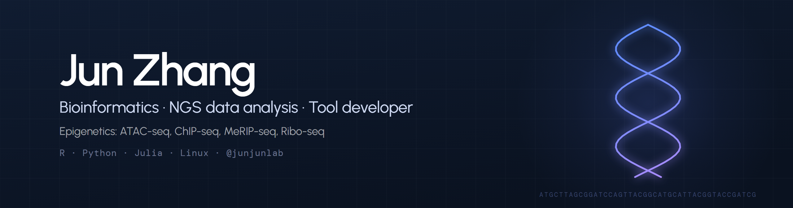

**NGS data analysis and bioinformatics tools.**

I am a PhD at China Pharmaceutical University in Nanjing. I write R and Python packages that turn sequencing data into figures a biologist can read, and I build small desktop and mobile apps for browsing that data.

**74** public repositories · **670** followers · **1,284** stars across the seven packages below

[Repositories](https://github.com/junjunlab?tab=repositories) · [ORCID](https://orcid.org/0000-0001-7692-9105)

## Featured packages

| Package | What it does | Stars |
| :--- | :--- | ---: |
| [scRNAtoolVis](https://github.com/junjunlab/scRNAtoolVis) | Plotting functions that make single-cell results readable | 408 |
| [ClusterGVis](https://github.com/junjunlab/ClusterGVis) | Cluster a gene expression matrix and draw it in one step | 392 |
| [GseaVis](https://github.com/junjunlab/GseaVis) | Visualize GSEA results | 239 |
| [jjAnno](https://github.com/junjunlab/jjAnno) | Annotation layer for ggplot2 | 121 |
| [transPlotR](https://github.com/junjunlab/transPlotR) | Draw gene structures and transcript models | 84 |
| [omicScope](https://github.com/junjunlab/omicScope) | One framework for transcriptomic data analysis | 22 |
| [riboTransVis](https://github.com/junjunlab/riboTransVis) | Ribosome profiling data analysis | 18 |

## Apps

| App | What it does | Stack | Downloads |
| :--- | :--- | :--- | ---: |
| [Orbit](https://github.com/junjunlab/Orbit) | Offline genome browser for BAM, bigWig, SEG and GTF, with vector export | JavaScript | 43 |
| [myigv](https://github.com/junjunlab/myigv) | IGV fork with offline annotations, multi-gene panels and BAM auto-indexing | Java | 65 |
| [PaperDaily](https://github.com/junjunlab/paperDaily) | Reads current Cell, Nature and Science issues, saves papers for offline reading | React Native | 130 |

## Research

Gene expression is regulated from chromatin accessibility to RNA modifications and translation. I build the tools that measure each step.

| Area | What I measure | Methods |
| :--- | :--- | :--- |
| Epigenomics | Chromatin accessibility and histone marks | ATAC-seq, ChIP-seq |
| Epitranscriptomics | RNA modifications, m6A in particular | MeRIP-seq |
| Translation | Ribosome occupancy and translation efficiency | Ribo-seq |
| Tooling | Reproducible analysis and readable figures | R, Python, Julia, Shiny |

## More packages

**R:** [ORFfinderR](https://github.com/junjunlab/ORFfinderR) · [bulkPseudotime](https://github.com/junjunlab/bulkPseudotime) · [JunJunZai](https://github.com/junjunlab/JunJunZai) · [metaplot](https://github.com/junjunlab/metaplot) · [ggSCvis](https://github.com/junjunlab/ggSCvis) · [ggcirclize](https://github.com/junjunlab/ggcirclize) · [ggChIPvis](https://github.com/junjunlab/ggChIPvis) · [RiboProfiler](https://github.com/junjunlab/RiboProfiler) · [BioSeqUtils](https://github.com/junjunlab/BioSeqUtils) · [jjPlot](https://github.com/junjunlab/jjPlot) · [tackPlotR](https://github.com/junjunlab/tackPlotR)

**Python:** [trackPy](https://github.com/junjunlab/trackPy) · [GetTransTool](https://github.com/junjunlab/GetTransTool) · [GetGeneLength](https://github.com/junjunlab/GetGeneLength) · [GetTsite](https://github.com/junjunlab/GetTsite)

## Shiny apps

[ClusterGVis](https://github.com/junjunlab/ClusterGvis-app) · [pheatmap](https://mp.weixin.qq.com/s?__biz=MzkyMTI1MTYxNA%3D%3D&mid=2247483697&idx=1&sn=264047d1c7a9205d39debe262978274b&chksm=c1873b40f6f0b256e118636c02d0f745cd016ffb8bc75436b8c6b6784c1927b17cdd64e1fb36&token=165425585&lang=zh_CN#rd) · [VennDiagram](https://mp.weixin.qq.com/s?__biz=MzkyMTI1MTYxNA%3D%3D&mid=2247483713&idx=1&sn=20bab779ddf6265b103250760e601fd6&chksm=c1873b30f6f0b226a8c94feb4929243bc147186a1f5765c4a43b78fd1fe5ff95e91562ab6591&token=165425585&lang=zh_CN#rd) · [volcanoPlot](https://mp.weixin.qq.com/s?__biz=MzkyMTI1MTYxNA%3D%3D&mid=2247483784&idx=1&sn=3fbd49c2efaef2fe59428fa5668c30f8&chksm=c1873bf9f6f0b2ef8c621bc4b3f99584264b80a6c8d70be4df6affa327f23ffe579183e3360b&token=165425585&lang=zh_CN#rd) · [qPCR](https://mp.weixin.qq.com/s?__biz=MzkyMTI1MTYxNA%3D%3D&mid=2247483927&idx=1&sn=c321da93160c17385e25a07f8f540b7f&chksm=c1873866f6f0b1707ad5051117e0ec1a3566fc64d6b1f5695efb7b64052c3bb8597f40c0a7d9&token=165425585&lang=zh_CN#rd) · [qPCRpro](https://mp.weixin.qq.com/s?__biz=MzkyMTI1MTYxNA%3D%3D&mid=2247484786&idx=1&sn=0915a628d8dca23ba03db7a8bca93b04&chksm=c1873f03f6f0b615cdcffcfd887bd9194f7f75264b93feca03c6f863ab0172f26475a7ceb3e4&token=165425585&lang=zh_CN#rd) · [clusterProfiler](https://mp.weixin.qq.com/s?__biz=MzkyMTI1MTYxNA%3D%3D&mid=2247492178&idx=1&sn=23d90a07bb6d6ceceea3d4ea26f7df93&chksm=c184d823f6f3513597b83dbf19f5ed4c58a2fcadf8f02e62df614b4025f228250c73e17837d9&token=165425585&lang=zh_CN#rd) · [CountToTPM/FPKM](https://mp.weixin.qq.com/s?__biz=MzkyMTI1MTYxNA%3D%3D&mid=2247483999&idx=1&sn=5e3b3afbaaa18692c68751a48b747dee&chksm=c187382ef6f0b138671e6fd594ee6a9a1f11912be1c177d07f9c1566364810583c8f486c00d0&token=165425585&lang=zh_CN#rd)

## Contact

[ORCID](https://orcid.org/0000-0001-7692-9105) · [GitHub](https://github.com/junjunlab) · Open an issue on the repository you are using.

Counts as of November 2026. Stars and downloads live on each repository.
