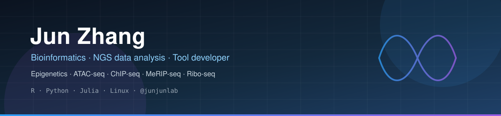

  

---

## 👋 About me

Hi, I'm **Jun Zhang** — a PhD at **China Pharmaceutical University (CPU)**. I work on **NGS (Next-Generation Sequencing) data analysis** and build **bioinformatics tools**, mostly in **R** and **Python**, with some **Julia** and a lot of **Linux**.

My research focuses on **epigenetics** and **sequencing data analysis**: **ATAC-seq**, **ChIP-seq**, **MeRIP-seq** and **Ribo-seq**, studying how gene expression is regulated from chromatin accessibility to RNA modifications and translation. I enjoy connecting wet-lab insight with computational tools to dig deeper into biological questions.

> 路漫漫其修远兮，吾将上下而求索。

## 🔬 What I work on

| Area | Focus |
| :-- | :-- |
| **Epigenomics** | ATAC-seq / ChIP-seq — chromatin accessibility & histone marks |
| **Epitranscriptomics** | MeRIP-seq — RNA modifications (m6A) |
| **Translation** | Ribo-seq — ribosome profiling & translation efficiency |
| **Tooling** | R / Python packages and Shiny apps for reproducible analysis |

## 🧰 Tech stack

  
  
  
  
  
   
  
  
  
  
  

## 📊 GitHub

 

## 🚀 Featured projects

| Project | What it does | Stars |
| :-- | :-- | :-- |
| **[scRNAtoolVis](https://github.com/junjunlab/scRNAtoolVis)** | Useful functions to make your scRNA-seq plots more cool |  |
| **[ClusterGVis](https://github.com/junjunlab/ClusterGVis)** | One-step cluster and visualize gene expression matrix |  |
| **[GseaVis](https://github.com/junjunlab/GseaVis)** | An R package to visualize GSEA results |  |
| **[jjAnno](https://github.com/junjunlab/jjAnno)** | An annotation package for ggplot |  |
| **[transPlotR](https://github.com/junjunlab/transPlotR)** | An elegant package to visualize gene structures |  |
| **[omicScope](https://github.com/junjunlab/omicScope)** | A comprehensive framework for transcriptomic data analysis |  |

## ✨ Shiny apps

<table>
  <tr>
    <td>🧩 <a href="https://github.com/junjunlab/ClusterGvis-app"><b>ClusterGVis</b></a></td>
    <td>🎨 <a href="https://mp.weixin.qq.com/s?__biz=MzkyMTI1MTYxNA==&mid=2247483697&idx=1&sn=264047d1c7a9205d39debe262978274b&chksm=c1873b40f6f0b256e118636c02d0f745cd016ffb8bc75436b8c6b6784c1927b17cdd64e1fb36&token=165425585&lang=zh_CN#rd"><b>pheatmap</b></a></td>
  </tr>
  <tr>
    <td>🔵 <a href="https://mp.weixin.qq.com/s?__biz=MzkyMTI1MTYxNA==&mid=2247483713&idx=1&sn=20bab779ddf6265b103250760e601fd6&chksm=c1873b30f6f0b226a8c94feb4929243bc147186a1f5765c4a43b78fd1fe5ff95e91562ab6591&token=165425585&lang=zh_CN#rd"><b>VennDiagram</b></a></td>
    <td>🌋 <a href="https://mp.weixin.qq.com/s?__biz=MzkyMTI1MTYxNA==&mid=2247483784&idx=1&sn=3fbd49c2efaef2fe59428fa5668c30f8&chksm=c1873bf9f6f0b2ef8c621bc4b3f99584264b80a6c8d70be4df6affa327f23ffe579183e3360b&token=165425585&lang=zh_CN#rd"><b>volcanoPlot</b></a></td>
  </tr>
  <tr>
    <td>🧪 <a href="https://mp.weixin.qq.com/s?__biz=MzkyMTI1MTYxNA==&mid=2247483927&idx=1&sn=c321da93160c17385e25a07f8f540b7f&chksm=c1873866f6f0b1707ad5051117e0ec1a3566fc64d6b1f5695efb7b64052c3bb8597f40c0a7d9&token=165425585&lang=zh_CN#rd"><b>qPCR</b></a></td>
    <td>📈 <a href="https://mp.weixin.qq.com/s?__biz=MzkyMTI1MTYxNA==&mid=2247484786&idx=1&sn=0915a628d8dca23ba03db7a8bca93b04&chksm=c1873f03f6f0b615cdcffcfd887bd9194f7f75264b93feca03c6f863ab0172f26475a7ceb3e4&token=165425585&lang=zh_CN#rd"><b>qPCRpro</b></a></td>
  </tr>
  <tr>
    <td>🧬 <a href="https://mp.weixin.qq.com/s?__biz=MzkyMTI1MTYxNA==&mid=2247492178&idx=1&sn=23d90a07bb6d6ceceea3d4ea26f7df93&chksm=c184d823f6f3513597b83dbf19f5ed4c58a2fcadf8f02e62df614b4025f228250c73e17837d9&token=165425585&lang=zh_CN#rd"><b>clusterProfiler</b></a></td>
    <td>🔢 <a href="https://mp.weixin.qq.com/s?__biz=MzkyMTI1MTYxNA==&mid=2247483999&idx=1&sn=5e3b3afbaaa18692c68751a48b747dee&chksm=c187382ef6f0b138671e6fd594ee6a9a1f11912be1c177d07f9c1566364810583c8f486c00d0&token=165425585&lang=zh_CN#rd"><b>CountToTPM/FPKM</b></a></td>
  </tr>
</table>

## 📦 R packages

<table>
  <tr>
    <td><a href="https://github.com/junjunlab/riboTransVis"><b>riboTransVis</b></a></td>
    <td><a href="https://github.com/junjunlab/ORFfinderR"><b>ORFfinderR</b></a></td>
    <td><a href="https://github.com/junjunlab/bulkPseudotime"><b>bulkPseudotime</b></a></td>
  </tr>
  <tr>
    <td><a href="https://github.com/junjunlab/JunJunZai"><b>JunJunZai</b></a></td>
    <td><a href="https://github.com/junjunlab/metaplot"><b>metaplot</b></a></td>
    <td><a href="https://github.com/junjunlab/ggSCvis"><b>ggSCvis</b></a></td>
  </tr>
  <tr>
    <td><a href="https://github.com/junjunlab/ggcirclize"><b>ggcirclize</b></a></td>
    <td><a href="https://github.com/junjunlab/ggChIPvis"><b>ggChIPvis</b></a></td>
    <td><a href="https://github.com/junjunlab/RiboProfiler"><b>RiboProfiler</b></a></td>
  </tr>
  <tr>
    <td><a href="https://github.com/junjunlab/BioSeqUtils"><b>BioSeqUtils</b></a></td>
    <td><a href="https://github.com/junjunlab/ClusterGVis"><b>ClusterGVis</b></a></td>
    <td><a href="https://github.com/junjunlab/jjPlot"><b>jjPlot</b></a></td>
  </tr>
  <tr>
    <td><a href="https://github.com/junjunlab/jjAnno"><b>jjAnno</b></a></td>
    <td><a href="https://github.com/junjunlab/transPlotR"><b>transPlotR</b></a></td>
    <td><a href="https://github.com/junjunlab/GseaVis"><b>GseaVis</b></a></td>
  </tr>
  <tr>
    <td><a href="https://github.com/junjunlab/scRNAtoolVis"><b>scRNAtoolVis</b></a></td>
    <td><a href="https://github.com/junjunlab/tackPlotR"><b>tackPlotR</b></a></td>
    <td></td>
  </tr>
</table>

## 🐍 Python tools

<table>
  <tr>
    <td><a href="https://github.com/junjunlab/trackPy"><b>trackPy</b></a></td>
    <td><a href="https://github.com/junjunlab/GetTransTool"><b>GetTransTool</b></a></td>
  </tr>
  <tr>
    <td><a href="https://github.com/junjunlab/GetGeneLength"><b>GetGeneLength</b></a></td>
    <td><a href="https://github.com/junjunlab/GetTsite"><b>GetTsite</b></a></td>
  </tr>
</table>

## 🔗 Connect

  
<i>Thanks for stopping by — feel free to explore the repos and ⭐ what you find useful.</i>

